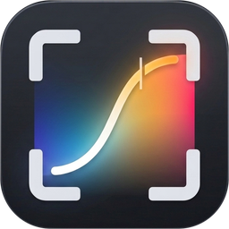
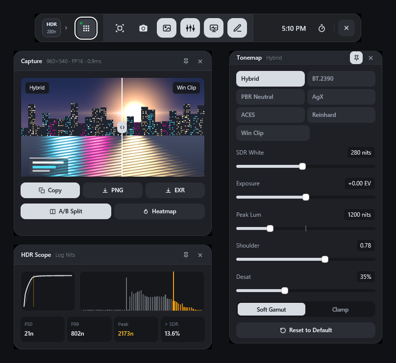
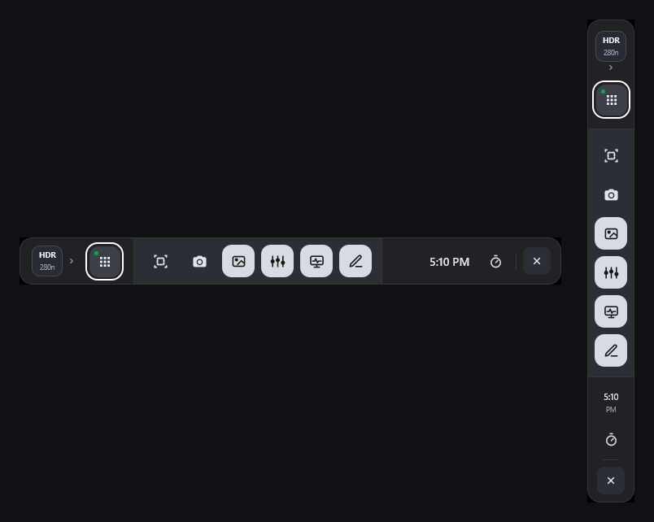
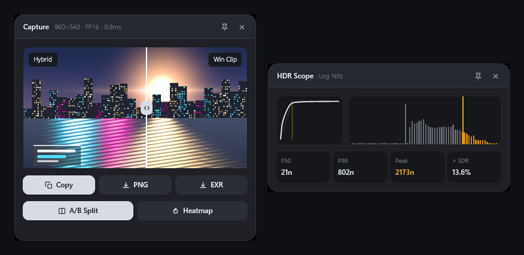
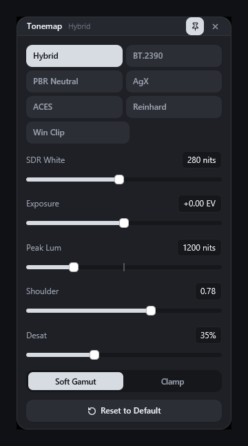
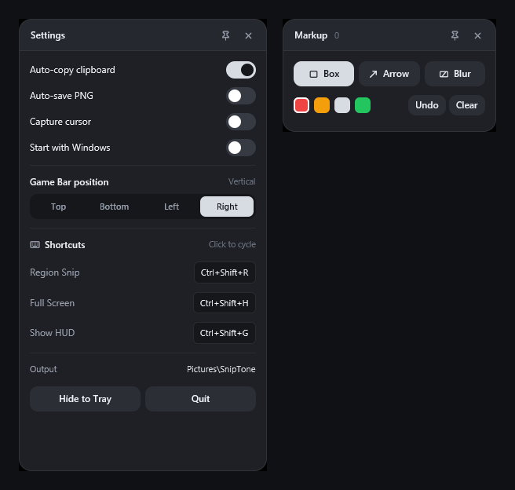
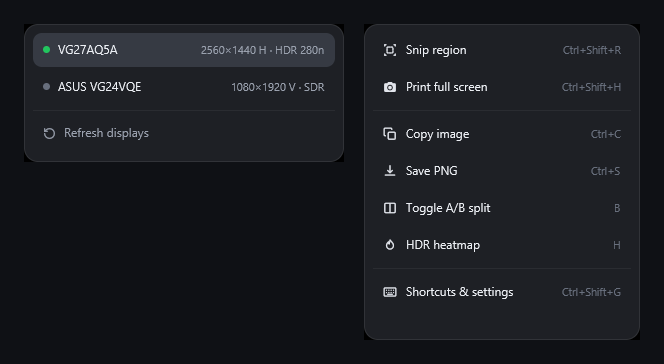

<p align="center">
  
</p>

<h1 align="center">SnipTone</h1>

<p align="center">
  Native Rust HDR screenshot &amp; tonemapping HUD for Windows 11, powered by <strong>GPUI</strong>.
</p>

<p align="center">
  
</p>

## Highlights

- **Native FP16 HDR Capture** — Captures `R16G16B16A16_FLOAT` scRGB frames via DXGI Desktop Duplication with automatic Windows Graphics Capture (WGC) fallback and live `SDRWhiteLevel` detection.
- **7 Tonemapping Operators** — `Hybrid SDR-Safe`, `BT.2390`, `PBR Neutral`, `AgX`, `ACES Fitted`, `Reinhard`, and `Win Clip`, with soft negative-scRGB gamut mapping, live tone curve, and one-click Reset to Default.
- **Zero-Cost GPU A/B Split & HDR Scope** — Hardware-clipped A/B split curtain against Windows Clip, HDR clipping heatmap, and 64-bin log-luminance histogram (`P50`, `P99`, `Peak`, `> SDR`).
- **Independent Floating HUD** — Each panel is its own borderless floating window (zero click-blocking overlay), with horizontal (`Top`/`Bottom`) and vertical (`Left`/`Right`) Game Bar docking, mixed landscape/portrait multi-monitor support, and live Windows Taskbar clearance on all 4 edges.
- **0% Idle Footprint** — Closes cleanly to the Windows System Tray, drops GPU preview textures when hidden, supports configurable global hotkeys, and optional **Start with Windows**.
- **Export** — Instant `CF_DIB` clipboard copy, full-resolution SDR PNG, and linear 32-bit float OpenEXR (`Pictures\SnipTone`).

## Screens

### Game Bar (Horizontal & Vertical Dock)
<p align="center">
  
</p>

### Capture Preview (A/B Split) & HDR Scope
<p align="center">
  
</p>

### Tonemap Controls
<p align="center">
  
</p>

### Settings, Global Shortcuts & Markup Tools
<p align="center">
  
</p>

### Display Switcher & Quick Capture Menu
<p align="center">
  
</p>

## Default Shortcuts

| Action | Default Shortcut |
|---|---|
| Region Snip | `Ctrl+Shift+R` |
| Full Screen Capture | `Ctrl+Shift+H` |
| Show / Hide HUD | `Ctrl+Shift+G` |
| Copy / Save PNG | `Ctrl+C` / `Ctrl+S` |
| Toggle A/B Split / Heatmap | `B` / `H` |

All global shortcuts can be customized in **Settings** and persist to `%LOCALAPPDATA%\SnipTone\config.json`.

## Build & Installers

**Requirements:** Windows 10/11 (x64), Rust toolchain (MSVC). For `.msi` / `.exe` installers: [WiX Toolset v5](https://wixtoolset.org/) (`dotnet tool install --global wix`).

```powershell
# Run in release mode
cargo run --release

# Run display & HDR capture diagnostics
cargo run -- --probe

# Run unit tests
cargo test

# Build native .msi and .exe installers into dist/
.\scripts\build-installers.ps1
```
